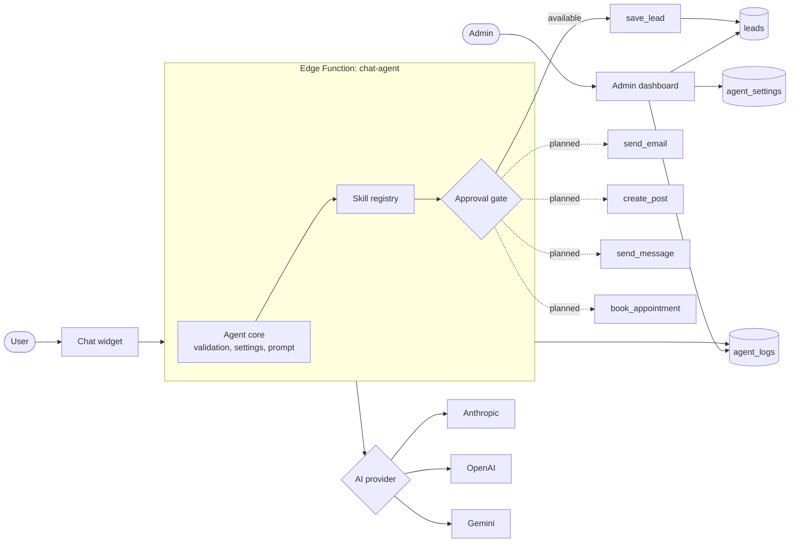

<!-- Optional: add a banner image at docs/banner.png, then uncomment the next line -->
<!-- <p align="center"></p> -->

<div align="center">

# Assistant Agent

### An AI assistant platform for everyday business tasks
**Chat with customers today. Write, email, post and automate next.**

*Built by [CupidCreativeX](https://cupidcreativex.com): Visually Transforming...*

<br/>


[Overview](#-overview) · [Capabilities](#-capabilities) · [Architecture](#-architecture) · [Quick start](#-quick-start) · [Add a new skill](#-adding-a-new-skill) · [Security](#-security) · [Roadmap](#-roadmap)

</div>

---

## 📖 Table of contents

1. [Overview](#-overview)
2. [Capabilities](#-capabilities)
3. [Example tasks](#-example-tasks)
4. [Architecture](#-architecture)
5. [Design principles](#-design-principles)
6. [Tech stack](#-tech-stack)
7. [Project structure](#-project-structure)
8. [Quick start](#-quick-start)
9. [Environment variables and secrets](#-environment-variables-and-secrets)
10. [Database](#-database)
11. [Edge function](#-edge-function)
12. [Admin dashboard](#-admin-dashboard)
13. [Configuring the agent for your business](#-configuring-the-agent-for-your-business)
14. [Adding a new skill](#-adding-a-new-skill)
15. [Adding the widget to a website](#-adding-the-widget-to-a-website)
16. [Deployment](#-deployment)
17. [Security](#-security)
18. [Troubleshooting](#-troubleshooting)
19. [Roadmap](#-roadmap)
20. [Contributing](#-contributing)
21. [License](#-license)
22. [Contact](#-contact)

---

## ✨ Overview

Assistant Agent is a configurable AI assistant for businesses. It started as a website chat agent, and it is designed to grow into an assistant that can handle many kinds of business work: answering customers, capturing leads, drafting and sending messages and emails, creating social posts, and more.

It is not tied to one company or one use case. The agent's behavior comes from three things you control:

- **A business profile and system prompt** that tell it who it works for and how to behave
- **Skills (tools)** that let it do things beyond talking, such as saving a lead
- **A choice of AI provider** (Anthropic, OpenAI or Google Gemini) switchable from the admin dashboard

CupidCreativeX is the first deployment, but any organization can use it by changing its configuration.

**Status legend used in this document**

| Badge | Meaning |
|---|---|
| ✅ Available | Built and working in this repository |
| 🚧 In development | Being built now |
| 🗺 Planned | On the roadmap, not yet built |

---

## 🚀 Capabilities

### Core platform

| Capability | Status | Details |
|---|---|---|
| Website chat widget | ✅ Available | Animated launcher, quick replies, typing indicator, responsive and accessible |
| Customer support answers | ✅ Available | Answers from the business profile in the system prompt |
| Lead capture | ✅ Available | The agent collects details and saves them through the `save_lead` skill |
| Multi-provider AI | ✅ Available | Anthropic (Claude), OpenAI (GPT) and Google (Gemini), selected in the admin dashboard |
| Provider fallback | ✅ Available | Optionally retry another configured provider if one fails |
| Admin dashboard | ✅ Available | Allowlisted sign-in, Leads tab and AI Agent tab |
| Request logging | ✅ Available | Provider, model, latency and status for each request |
| Human handoff | ✅ Available | Shares phone and email when a person is needed |

### Business task skills

| Skill | Status | What it will do |
|---|---|---|
| Message drafting | 🗺 Planned | Generate replies, follow-ups, announcements and proposals in the business's voice |
| Email | 🗺 Planned | Draft emails and send them after approval |
| Social media posts | 🗺 Planned | Generate posts and captions, then publish or schedule after approval |
| Messaging channels | 🗺 Planned | WhatsApp, SMS and Telegram conversations |
| Bookings and scheduling | 🗺 Planned | Calendar availability and appointment booking |
| Knowledge base | 🗺 Planned | Answers from live tables and documents (services, FAQs, pricing) |
| Reports and summaries | 🗺 Planned | Lead summaries, conversation digests and activity reports |
| Workflows | 🗺 Planned | Chain steps together, such as new lead, draft follow-up, notify team |

---

## 🧪 Example tasks

Today the agent handles conversations and lead capture. These are the kinds of requests the platform is being built to support.

| Request | Status |
|---|---|
| "What services do you offer?" | ✅ Available |
| "I'd like a quote for a website." (collects details and saves a lead) | ✅ Available |
| "Write a follow-up email to the lead who asked about app development." | 🗺 Planned |
| "Draft a post announcing our new offer for LinkedIn and Instagram." | 🗺 Planned |
| "Send this message to everyone who requested a quote this week." | 🗺 Planned |
| "Summarize this week's leads." | 🗺 Planned |

---

## 🏗 Architecture



**Request flow**

1. The user sends a message from the widget.
2. The `chat-agent` Edge Function validates it, checks the allowed origin and loads the active settings.
3. The agent core sends the conversation, the system prompt and the available skills to the selected provider.
4. If the model asks to use a skill, the registry runs it. Skills that act on the outside world pass through an approval gate first.
5. The reply returns to the user, and the request is logged.

---

## 🧭 Design principles

| Principle | What it means |
|---|---|
| **Provider-agnostic** | One interface for every AI provider, so you can switch without rewriting anything |
| **Skills, not hard-coded features** | Every action is a skill with a name, a schema and a handler, so new abilities plug in cleanly |
| **Human approval for outside actions** | Sending an email, publishing a post or messaging a person requires approval by default |
| **Keys stay on the server** | Provider and channel credentials live only in server-side secrets |
| **Configurable per business** | Name, offer, tone, services and contact details come from configuration, not code |
| **Everything is logged** | Requests and skill runs are recorded so you can audit what the agent did |

---

## 🧰 Tech stack

| Layer | Technology |
|---|---|
| Frontend | React, TypeScript, Vite |
| Styling | Tailwind CSS |
| Animation and icons | Framer Motion, Lucide React |
| Backend | Supabase (Postgres, Auth, Edge Functions) |
| AI providers | Anthropic, OpenAI, Google Gemini |
| Hosting | Vercel (frontend), Supabase (functions and database) |

---

## 🗂 Project structure

```text
assistant-agent/
├── src/                      # React app: widget, admin dashboard, shared libs
│   └── lib/                  # Supabase client and shared types
├── supabase/
│   ├── functions/
│   │   └── chat-agent/       # Edge Function: validation, provider adapters, skills, logging
│   └── migrations/           # SQL migrations (tables, RLS policies, functions)
├── index.html
├── tailwind.config.js
├── vite.config.ts
├── vercel.json               # Rewrites so /admin works on direct visits
└── package.json
```

---

## ⚡ Quick start

### Prerequisites

- Node.js 18 or newer
- A Supabase project
- At least one AI provider API key (Anthropic, OpenAI or Gemini)
- The Supabase CLI, run through `npx supabase`

### 1. Clone and install

```bash
git clone https://github.com/cupidnavaz/assistant-agent.git
cd assistant-agent
npm install
```

### 2. Configure the frontend

Create a `.env` file in the project root:

```bash
VITE_SUPABASE_URL=https://YOUR_PROJECT_REF.supabase.co
VITE_SUPABASE_ANON_KEY=your_public_anon_key
```

Use only the public anon key here. Never put AI keys in this file.

### 3. Link Supabase and apply the database

```bash
npx supabase login
npx supabase link --project-ref YOUR_PROJECT_REF
npx supabase db push --dry-run   # review first
npx supabase db push
```

### 4. Set the function secrets and deploy

```bash
npx supabase secrets set OPENAI_API_KEY=your_key
npx supabase secrets set ALLOWED_ORIGINS="https://your-domain.com,http://localhost:5173"
npx supabase functions deploy chat-agent
```

Add `ANTHROPIC_API_KEY` and `GEMINI_API_KEY` the same way if you want those providers.

### 5. Run locally

```bash
npm run dev
```

Open `http://localhost:5173`, then visit `/admin` to sign in.

---

## 🔑 Environment variables and secrets

| Name | Where it lives | Purpose |
|---|---|---|
| `VITE_SUPABASE_URL` | `.env` and Vercel | Supabase project URL |
| `VITE_SUPABASE_ANON_KEY` | `.env` and Vercel | Public anon key |
| `OPENAI_API_KEY` | Supabase secrets | OpenAI access |
| `ANTHROPIC_API_KEY` | Supabase secrets | Anthropic access |
| `GEMINI_API_KEY` | Supabase secrets | Gemini access |
| `ALLOWED_ORIGINS` | Supabase secrets | Comma-separated list of sites allowed to call the function |

Future skills that connect to other services (email, social platforms, messaging) will add their own secrets, which must also live in Supabase secrets.

> **Rule of thumb:** secrets go in Supabase secrets only. Anything prefixed with `VITE_` is shipped to the browser.

---

## 🗄 Database

| Table | Purpose |
|---|---|
| `leads` | Leads captured by the chat (source `chat-widget`) |
| `chat_sessions` | Stored conversations |
| `agent_settings` | Active provider, models, temperature, token limit, system prompt, fallback toggle |
| `agent_logs` | Provider, model, latency and status for each request |
| `admin_emails` | Allowlist of emails permitted to use the admin dashboard |

- Row Level Security is enabled on all tables.
- Admin access is checked by the `is_lead_admin()` function against `admin_emails`.
- The Edge Function uses the service role for writes. The browser never does.

**Adding an admin**

```sql
insert into admin_emails (email) values ('you@example.com');
```

Then create the account on the `/admin` sign-in screen with the same email.

---

## 🧠 Edge function

`supabase/functions/chat-agent` is the agent's brain. It:

- Validates input and rate limits requests
- Checks the request origin against `ALLOWED_ORIGINS`
- Loads `agent_settings` and selects the provider
- Translates each skill's definition into the provider's tool-calling format
- Runs skills and returns the reply
- Logs every request to `agent_logs`
- Falls back to another provider when enabled and a call fails

```bash
npx supabase functions deploy chat-agent
npx supabase functions logs chat-agent
```

---

## 🛠 Admin dashboard

Visit `/admin` and sign in with an allowlisted email.

| Tab | Status | What you can do |
|---|---|---|
| **Leads** | ✅ Available | Review leads captured by the chat |
| **AI Agent** | ✅ Available | Choose the provider, set model names, adjust temperature and token limit, edit the system prompt, toggle fallback, review recent request logs |
| **Skills** | 🗺 Planned | Turn skills on or off and choose which ones need approval |
| **Approvals** | 🗺 Planned | Review and approve drafts the agent wants to send or publish |
| **Activity** | 🗺 Planned | Audit trail of every action the agent took |

Switch off public sign-up once your admin account exists. In Supabase, open **Authentication → Providers → Email**.

---

## 🎛 Configuring the agent for your business

The agent is meant to be reused. To adapt it to a different business, change the configuration, not the code.

**1. Edit the system prompt** from the admin **AI Agent** tab. Include:

- Who the business is and what it does
- Its services, offers, hours and contact details
- The tone of voice (formal, friendly, concise)
- What the agent must never do, such as quote prices or make guarantees
- When to hand off to a person

**2. Update the branding** in the Tailwind config: colors, fonts and the widget's logo.

**Example brand palette (CupidCreativeX)**

| Role | Color |
|---|---|
| Primary purple | `#2B1A5E` |
| Accent orange | `#FF6A00` |
| Indigo | `#4B2FD0` |
| Lavender surface | `#F1ECFF` |

Fonts: **Fraunces** for headings and **Inter** for body text.

**3. Choose the provider and model** in the admin dashboard, and test it with real questions before going live.

---

## 🧩 Adding a new skill

A skill is a capability the agent can use, such as saving a lead, sending an email or publishing a post. `save_lead` is the reference example.

1. **Define the skill:** a name, a plain-language description of when to use it, and a schema for its inputs.
2. **Write the handler** in the Edge Function. It receives the validated inputs, performs the action and returns a result the agent can read.
3. **Register it** so the agent core offers it to every provider in that provider's tool-calling format.
4. **Choose its approval mode:**
   - *Automatic* for safe, internal actions such as saving a lead
   - *Requires approval* for anything that reaches the outside world, such as sending an email or publishing a post
5. **Store its credentials** (for example, an email service key) as Supabase secrets, never in code.
6. **Log every run** to the activity log.
7. **Test with each provider,** because tool calling can behave differently between models.
8. **Update this README:** add the skill to the capabilities table with its status.

---

## 🔌 Adding the widget to a website

If the widget lives in a separate repo from your website, copy it into the website repo:

1. Copy the widget components, the hooks and libs they use, `supabase/functions/chat-agent` and the migrations.
2. Merge the Tailwind brand colors and fonts without overriding existing styles.
3. Mount the widget once in the website's main layout.
4. Point it at the website's existing Supabase client and environment variables.
5. Add the SPA rewrite for `/admin` to the website's `vercel.json`.
6. Install any missing packages, usually `framer-motion` and `lucide-react`.

---

## 🌍 Deployment

**Frontend (Vercel)**

1. Import the repository in Vercel.
2. Add `VITE_SUPABASE_URL` and `VITE_SUPABASE_ANON_KEY` under **Settings → Environment Variables**.
3. Deploy. Pushes to `main` redeploy automatically, and branches get preview URLs.

**Backend (Supabase)**

1. Apply migrations with `npx supabase db push`.
2. Set secrets with `npx supabase secrets set ...`.
3. Deploy the function with `npx supabase functions deploy chat-agent`.

**Go-live checklist**

- [ ] Database backup taken before the first migration
- [ ] `db push --dry-run` reviewed
- [ ] Provider key set and tested from the admin **AI Agent** tab
- [ ] `ALLOWED_ORIGINS` includes the production domain
- [ ] Admin email in `admin_emails`, account created, public sign-up disabled
- [ ] A test lead appears in the Leads tab
- [ ] Direct visit to `/admin` works on the live site

---

## 🔒 Security

- Provider and service keys are stored only as Supabase secrets and are never sent to the browser.
- `ALLOWED_ORIGINS` restricts which sites can use the function. Never set it to `*`.
- RLS is enabled on every table, and only allowlisted admins can read settings and leads.
- Inputs are validated and requests are rate limited.
- **Actions that affect people outside the system (emails, messages, posts) must require human approval by default.** Turn on automatic mode only for skills you fully trust, and keep an audit log.
- Give each connected service the minimum permissions it needs.
- Never commit `.env` files, service role keys or provider keys.
- If a key is ever exposed, rotate it immediately in the provider's dashboard.
- Set monthly spending limits with each AI provider.
- When sending messages or emails to customers, follow the consent and unsubscribe rules that apply in your region.

To report a vulnerability, email **info@cupidcreativex.com**.

---

## 🩺 Troubleshooting

| Problem | Likely cause | Fix |
|---|---|---|
| `supabase` is not recognized | CLI not installed globally | Use `npx supabase ...` |
| Chat is blocked or shows a CORS error | Domain missing from `ALLOWED_ORIGINS` | Add it and redeploy the function |
| Chat returns no reply | Missing or invalid provider key, or no billing credit | Check secrets and the function logs |
| `/admin` returns 404 on Vercel | Missing SPA rewrite | Make sure `vercel.json` rewrites routes to `index.html` |
| Admin shows no data | Email not in `admin_emails` | Add it and sign in with that exact email |
| `db push` reports a history mismatch | Remote has migrations the repo lacks | Run `npx supabase db pull`, then retry |
| "Relation already exists" | Table name conflicts with an existing one | Review the dry run and adapt the migration |

---

## 🗺 Roadmap

**Phase 1: Foundation (current)**
- [x] Website chat widget
- [x] Lead capture
- [x] Multi-provider AI with admin switching and fallback
- [x] Admin dashboard with Leads and AI Agent tabs
- [x] Request logging

**Phase 2: Skills framework**
- [ ] Skill registry with per-skill on/off and approval settings
- [ ] Approvals queue and activity log in the admin dashboard
- [ ] Knowledge base tables (services, FAQs) the agent can read live

**Phase 3: Writing and outreach**
- [ ] Message and email drafting in the business's voice
- [ ] Email sending with approval
- [ ] Social post generation, scheduling and publishing with approval

**Phase 4: Channels and workflows**
- [ ] WhatsApp, SMS and Telegram
- [ ] Booking and calendar integration
- [ ] Multi-step workflows and automations
- [ ] Reports, summaries and analytics

**Phase 5: Multi-business**
- [ ] Separate business profiles with their own prompts, branding and skills
- [ ] Multi-language replies
- [ ] Team roles and permissions

---

## 🤝 Contributing

1. Create a branch: `git checkout -b feature/your-feature`
2. Make your changes and run `npm run lint`
3. Update the capabilities table if you add or change a skill
4. Commit with a clear message
5. Open a pull request describing what changed and why

---

## 📄 License

Released under the MIT License. Add a `LICENSE` file to the repository root to make this official.

---

## 📬 Contact

**CupidCreativeX: Visually Transforming...**

| | |
|---|---|
| 📞 Phone | 0707988777, 09039454419 |
| ✉️ Email | info@cupidcreativex.com |
| 🌐 Website | [cupidcreativex.com](https://cupidcreativex.com) |

<div align="center">

**Your Partner in Digital Transformation**

</div>
